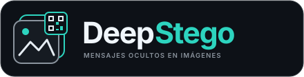

<h1 align="center">
  
</h1>

<p align="center">
  <strong>Una fotografía. Un mensaje oculto.</strong><br>
  DeepStego oculta mensajes cortos dentro de fotografías mediante códigos QR y redes neuronales.<br>
  Escribe, oculta y recupera tu mensaje desde una interfaz web sencilla.
</p>

<p align="center">
  <a href="pyproject.toml"></a>
  <a href="https://pytorch.org/"></a>
  <a href="https://www.gradio.app/"></a>
  <a href="LICENSE"></a>
</p>

## Iniciar la web

Con **Python ≥3.10** y [uv](https://docs.astral.sh/uv/getting-started/installation/) instalados, ejecuta desde la raíz del proyecto:

```bash
uv run --extra app python -m deepstego.app
```

Abre **[127.0.0.1:7860](http://127.0.0.1:7860)**. La aplicación carga `checkpoints/best.pt` y funciona en CPU.

## Ocultar y recuperar

1. **Ocultar:** carga una fotografía, escribe hasta **20 caracteres** y descarga el PNG con el mensaje.
2. **Revelar:** vuelve a cargar ese PNG para reconstruir el QR y leer el texto.

> La fotografía se ajusta a **128 × 128 píxeles**. Conserva el PNG descargado sin redimensionarlo ni convertirlo a JPEG.

## Video
[Link a Youtube](https://youtu.be/5oeijoNcvb0)

---

<p align="center">
  <a href="docs/Propuesta_Proyecto_DeepStego.md">Propuesta</a> ·
  <a href="notebooks/train_kaggle.ipynb">Notebook de entrenamiento</a> ·
  <a href="LICENSE">Licencia</a><br>
  <sub>Proyecto académico · TEL-328 · Procesamiento Digital de Imágenes</sub>
</p>
